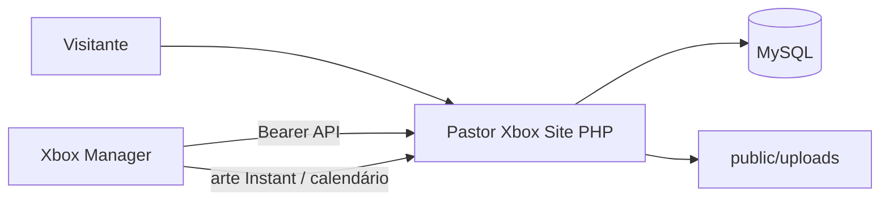

# Pastor Xbox Site — Documentação técnica

Documentação do site público **Pastor Xbox** (`pastorxbox.com.br`): vitrine PHP 8 + MySQL, sem painel editorial próprio. A edição de conteúdo é feita pelo **Xbox Manager** (Next.js), que chama a API Bearer deste site.

| Item | Valor |
| --- | --- |
| Repositório | [pastorxbox/XboxPastorSite](https://github.com/pastorxbox/XboxPastorSite) |
| Versão principal (GitHub) | `v1.1.0` (Latest) — baseline com documentação; reverter via tag + dump em `backups/` |
| Stack | PHP 8.3, MySQL/MariaDB (`utf8mb4`), Apache/LiteSpeed |
| Document root | `public/` |
| Config | Fora do web root: `config/config.php` (+ `.env`) |
| Idiomas UI/conteúdo | `pt` (canônico), `en`, `es` |
| Asset cache-bust | `20261103navright2` em `public/includes/vitrine-layout.php` |

---

## 1. Visão geral



- **Site:** renderiza home, notícias, artigos, calendário, busca, TV Xbox, anúncios, RSS, PWA/push.
- **Manager:** cria/edita posts, Game Pass, eventos, história Xbox, mídia, brand, home “hoje”, ads, TV Xbox.
- **Sem CMS no site:** escrita só via `/api/*` autenticada.

---

## 2. Estrutura do repositório

| Caminho | Função |
| --- | --- |
| `public/` | Document root (HTML, API, assets, uploads) |
| `public/api/index.php` | Front controller da API |
| `public/index.php` | Front controller das páginas HTML |
| `public/includes/` | Módulos PHP (domínio + API) |
| `public/assets/{css,js,img}/` | Frontend estático |
| `public/uploads/` | Mídia enviada (`YYYY/MM/…`); PHP bloqueado |
| `config/` | `config.php` / `.env` (fora do web root) |
| `sql/` | Migrations MySQL ordenadas |
| `tools/` | CLI: `init-db.php`, import WP, VAPID |
| `deploy/` | Scripts SFTP/SSH para Hostinger |
| `docker/` + `docker-compose.yml` | Ambiente local |
| `docs/` | Planos de cutover/Hostinger |
| `composer.json` | `ezyang/htmlpurifier`, `minishlink/web-push` |

---

## 3. Runtime e configuração

### 3.1 Bootstrap HTML

1. `public/index.php` carrega `config/config.php` (ou `/var/www/config/config.php` no Docker).
2. Conecta PDO (`includes/db.php`).
3. Resolve rota por query/`PATH_INFO`/rewrite e renderiza via `render_vitrine_page()`.

### 3.2 Bootstrap API

1. `public/api/index.php` carrega config + `vendor/autoload.php`.
2. Inclui módulos `api-*.php` e despacha por path (`api_route_path()`).

### 3.3 Chaves de config (sem segredos)

| Env / chave | Uso |
| --- | --- |
| `SITE_BASE_URL` | URL pública absoluta |
| `SITE_API_KEY` | Bearer da API de escrita |
| `GA_MEASUREMENT_ID` | Google Analytics 4 (vazio = off) |
| `X_SCREEN_NAME` | Handle do embed X/Twitter |
| `WP_REST_BASE_URL` | Fonte do import WordPress |
| `VAPID_PUBLIC_KEY` / `VAPID_PRIVATE_KEY` / `VAPID_SUBJECT` | Web Push |
| `DB_HOST` / `DB_NAME` / `DB_USER` / `DB_PASSWORD` | MySQL |
| `site_name` | Nome da marca (default `Pastor Xbox`) |
| `db.charset` | `utf8mb4` |

Modelo local: `.env.example`.

### 3.4 Local (Docker)

```bash
docker compose up --build
```

- Site: `http://localhost:8080`
- phpMyAdmin: `http://127.0.0.1:8081`

---

## 4. Rotas públicas (HTML)

Rewrite em `public/.htaccess`: paths amigáveis → `index.php`; `/api` → `api/index.php`.

### 4.1 Query params

| Param | Efeito |
| --- | --- |
| `p` | Artigo por `posts.id` |
| `secao` | `noticias` \| `artigos` \| `calendario` \| `busca` |
| `tag` | Listagem por slug de tag |
| `paged` | Paginação (1-based) |
| `q` | Busca (com `secao=busca`) |
| `lang` | `pt` \| `en` \| `es` (grava cookie `px_lang`) |

### 4.2 Páginas

| Rota | Conteúdo |
| --- | --- |
| `/` | Home paginada (16 posts), carrossel, slide “hoje”, ticker do calendário |
| `/?p={id}` | Post publicado (OG, share, ads in-article) |
| `/noticias` | Lista seção `news` |
| `/artigos` | Lista seção `article` |
| `/calendario` | Game Pass + eventos + história Xbox (filtros, vista mês) |
| `/busca?q=` | Busca em posts + calendário |
| `/tag/{slug}` | Posts da tag |
| `/rss.xml` | RSS dos últimos 50 posts |
| `/calendario/rss.xml` | RSS do calendário |
| `/health` | `{ "ok": true }` |
| `/manifest.webmanifest` | PWA |
| `/sw.js` | Service worker (shell + push) |

Shell comum: header (marca, busca, nav progressiva, idioma), ads, sidebar TV Xbox / X embed, cookies/GA.

### 4.3 Header (comportamento atual)

- Brand à esquerda.
- Bloco direito: **busca + menu + idioma** (`margin-left: auto` no `.site-search`).
- Mobile/tablet: ícones sempre; rótulos aparecem progressivamente (Notícias → Artigos → Calendário → Início conforme a largura).
- Sem hamburger na versão `v1.0.0`.

---

## 5. Módulos PHP (`public/includes/`)

| Arquivo | Função |
| --- | --- |
| `db.php` | Conexão PDO |
| `helpers.php` | Escape, URLs, excerpts, YouTube, datas, ícones |
| `i18n.php` | Idiomas, strings UI, `site_settings`, logo |
| `posts.php` | CRUD/queries de posts e traduções |
| `tags.php` | Seções e tags |
| `content.php` | HTML de cards, carrossel, 404, busca |
| `calendar.php` | Game Pass / eventos / história (queries + render + RSS) |
| `tvxbox.php` | Playlist TV Xbox + sync de trailer com release |
| `ads.php` | Slots/slides de anúncio |
| `home-today.php` | Slide “Chegando Hoje” (settings) |
| `feed.php` | Geração RSS |
| `push.php` | VAPID + subscriptions + notify |
| `share.php` | Intents de compartilhamento |
| `vitrine-layout.php` | Documento HTML completo + versão de assets |
| `api-common.php` | Auth, HTTPS, JSON, HTMLPurifier |
| `api-posts.php` | API posts + i18n settings |
| `api-media.php` | Upload de imagem |
| `api-calendar.php` | API calendário |
| `catalog.php` / `api-catalog.php` | Espelho Catálogo Xbox (Manager → site) |
| `api-ads.php` | API ads |
| `api-tvxbox.php` | API TV Xbox |
| `api-brand.php` | Logo da marca |
| `api-home-today.php` | Slide home-today |
| `api-push.php` | VAPID público + subscribe |

---

## 6. API REST

### 6.1 Regras comuns

- **Auth (quase tudo):** `Authorization: Bearer {SITE_API_KEY}` (`hash_equals`).
- **HTTPS** obrigatório fora de localhost (respeita `X-Forwarded-Proto`).
- Corpo JSON até ~8 MB; erros `{ "error": "…" }`.
- HTML sanitizado com HTMLPurifier (`p,br,strong,em,a,ul,ol,li,blockquote,h2-h4,img`).
- Body de **história Xbox** é texto simples (`strip_tags`).

### 6.2 Endpoints

#### Saúde / Push (público)

| Método | Path | Auth | Resposta |
| --- | --- | --- | --- |
| GET | `/health` | não | `{ "ok": true }` |
| GET | `/api/push/vapid-public-key` | não (HTTPS) | `{ "publicKey" }` |
| POST | `/api/push/subscribe` | não (HTTPS) | `{ "ok": true }` |
| DELETE | `/api/push/subscribe` | não (HTTPS) | `{ "ok": true }` |

Subscribe body: `endpoint`, `keys.p256dh`, `keys.auth`, `contentEncoding?`.

#### Posts

| Método | Path | Notas |
| --- | --- | --- |
| GET | `/api/posts` | `page`, `per_page`, `section`, `status`, `q` → lista |
| POST | `/api/posts` | cria → `{ id, url }` |
| GET | `/api/posts/{id}` | detalhe + tags + translations |
| POST/PATCH | `/api/posts/{id}` | update; patch só de `featured_video_url` permitido |
| GET/POST… | `/api/posts/{id}/translations/{en\|es}` | tradução EN/ES |

Payload post: `title`, `body`, `status?`, `section?` (`news`\|`article`), `published_at?`, `tags?`, `featured_video_url?`.

#### Settings

| Path | Uso |
| --- | --- |
| `/api/settings/i18n` | GET/POST mapa de strings `{ settings: { key: { pt, en, es } } }` |
| `/api/settings/brand` | GET logo; POST multipart `file`; PUT clear |
| `/api/settings/home-today` | GET/PUT slide “hoje”; DELETE limpa |

Home-today payload: `date` (YYYY-MM-DD), `image_url`, `target` (`xbox`\|`gamepass`), `titles[]`, `signature?`.

#### Mídia

| Método | Path | Payload | Resposta |
| --- | --- | --- | --- |
| POST | `/api/media` | multipart `file` (jpeg/png/gif/webp/**avif**) | `{ url: "/uploads/YYYY/MM/…" }` |

#### Calendário — Game Pass

| Método | Path |
| --- | --- |
| GET/POST | `/api/calendar/gamepass` |
| GET/POST/PATCH/DELETE | `/api/calendar/gamepass/{id}` |

Campos principais:

- Identidade: `title`, `slug?`, `cover_url?`, `store_url` / `storeUrl`, `trailer_url` / `youtube_url`, `release_at` (**obrigatório**), `body?`, `status?`, `sort_order?`
- Preço: `price_brl` / `priceBRL` / `price`
- Assinaturas: `on_gamepass`, `on_ultimate`, `on_premium`, `on_essential`, `on_pc`
- Plataformas: `platform_console` (Series X\|S), `platform_xbox_one` / `platformXboxOne`, `platform_handheld` / `platformHandheld`, `platform_pc`, `platform_cloud`
- Extras: `play_anywhere` / `playAnywhere`, `supports_pt_br` / `supportsPtBr`, `show_on_tv`

Efeito colateral: `tvxbox_sync_release_trailer()` quando trailer / `show_on_tv` mudam.

#### Catálogo Xbox (Fase 2)

| Método | Path | Notas |
| --- | --- | --- |
| PUT | `/api/catalog/games/{manager_game_id}` | Upsert `catalog_games` + produtos + `catalog_price_mirror`. **Nunca** altera `gp_releases.price_brl`. |
| PUT | `/api/calendar/gamepass/{id}/catalog-link` | Só `catalog_game_id` (nullable) em `gp_releases`. |
| GET | `/api/calendar/gamepass` | Inclui `catalog_game_id` em cada item (nullable). |

Payload do upsert: `manager_game_id`, `slug`, `title`, `synopsis?`, `cover_url?`, `status`, `franchise?`, `products[]` (com `price?`), `do_not_overwrite_price_brl: true`.  
Resposta: `{ id, slug, manager_game_id }`.  
SQL: `sql/022_catalog_fase2.sql`. Deploy: `deploy/deploy-catalog-fase2.py`.

#### Calendário — Eventos / História

| Coleção | Payload-chave |
| --- | --- |
| `/api/calendar/events` | `title`, `banner_url?`, `starts_at`, `ends_at` (span ≤ 7 dias), `body?`, `external_url?`, `status?` |
| `/api/calendar/history` | `title`, `occurred_year/month/day`, `context?`, `body?`, `cover_url?`, `status?` |

Traduções: `/api/calendar/{gamepass|events|history}/{id}/translations/{en|es}`  
(nota: path `events` mapeia entity_type `event`).

#### Ads

| Path | Função |
| --- | --- |
| GET `/api/ads` | Lista slots |
| PATCH `/api/ads/slots/{slug}` | `enabled`, `width_px`, `height_px` |
| POST `/api/ads/slots/{slug}/slides` | cria slide |
| PATCH/DELETE `/api/ads/slides/{id}` | update/delete slide |

Slugs: `header`, `sidebar_top`, `sidebar_bottom`, `in_feed`, `in_article`.

#### TV Xbox

| Path | Função |
| --- | --- |
| GET/POST `/api/tvxbox` | lista / cria |
| GET/POST/PATCH/DELETE `/api/tvxbox/{id}` | item |
| POST `/api/tvxbox/link` | liga `gp_release_id` ↔ `tv_video_id` |
| `…/translations/{en\|es}` | tag/comment traduzidos |

---

## 7. Banco de dados

### 7.1 Migrations (`sql/`)

| Arquivo | Resumo |
| --- | --- |
| `001_schema.sql` | `posts`, `post_translations`, `site_settings` |
| `002_seed.sql` | Post seed |
| `003_taxonomy.sql` | `tags`, `post_tags` |
| `004_calendar.sql` | `gp_releases`, `calendar_events`, `xbox_history` |
| `005_calendar_seed.sql` | Seeds calendário |
| `006_ads.sql` | `ad_slots`, `ad_slides` |
| `007_releases_on_gamepass.sql` | `on_gamepass` |
| `008_releases_store_url.sql` | `store_url` |
| `009_releases_trailer_url.sql` | `trailer_url` |
| `010_i18n.sql` | Reforço i18n |
| `011_releases_play_anywhere_ptbr.sql` | `play_anywhere`, `supports_pt_br` |
| `011_calendar_i18n.sql` | `calendar_translations` |
| `012` / `013` ads dimensions | `width_px`, `height_px` |
| `014_push_subscriptions.sql` | `push_subscriptions` |
| `015_tv_xbox.sql` | `tv_videos` |
| `016_gp_releases_show_on_tv.sql` | `show_on_tv` |
| `017_events_ends_at.sql` | `calendar_events.ends_at` |
| `017_tv_videos_expires_at.sql` | `tv_videos.expires_at` |
| `018_releases_price_brl.sql` | `price_brl` |
| `019_tv_video_translations.sql` | `tv_video_translations` |
| `020_posts_featured_video.sql` | `posts.featured_video_url` |
| `021_releases_platform_xbox_one_handheld.sql` | `platform_xbox_one`, `platform_handheld` |

`tools/init-db.php` aplica um subconjunto; em Hostinger incremental aplicar migrations faltantes manualmente (ex.: `019`–`021`).

### 7.2 Tabelas (schema efetivo)

#### `posts`
`id`, `title`, `body`, `featured_video_url`, `status` (`draft`\|`published`), `section` (`news`\|`article`), `published_at`, `created_at`, `updated_at`

#### `post_translations`
`post_id`, `lang` (`en`\|`es`), `title`, `body`, `status`, timestamps — UNIQUE `(post_id, lang)`

#### `tags` / `post_tags`
Taxonomia M2M posts ↔ tags (`slug`, `name`)

#### `site_settings`
`setting_key`, `setting_value` (JSON), `updated_at`  
Chaves usadas: `section_translations`, `brand.assets`, `home.today_slide`

#### `gp_releases` (Game Pass / lançamentos)
`title`, `slug`, `cover_url`, `store_url`, `price_brl`, `trailer_url`, `show_on_tv`, `release_at`, `body`,  
`on_gamepass`, `on_ultimate`, `on_premium`, `on_essential`, `on_pc`,  
`platform_console`, `platform_xbox_one`, `platform_handheld`, `platform_pc`, `platform_cloud`,  
`play_anywhere`, `supports_pt_br`, `status`, `sort_order`, timestamps

**Mapeamento UI Manager → coluna:**

| Checkbox Manager | Coluna |
| --- | --- |
| Xbox Series X\|S | `platform_console` |
| Xbox One | `platform_xbox_one` |
| Handheld | `platform_handheld` |
| PC | `platform_pc` |
| Nuvem | `platform_cloud` |

#### `calendar_events`
`title`, `banner_url`, `starts_at`, `ends_at`, `body`, `external_url`, `status`, timestamps

#### `xbox_history`
`title`, `occurred_year`, `occurred_month`, `occurred_day`, `context`, `body`, `cover_url`, `status`, timestamps

#### `calendar_translations`
`entity_type` (`gamepass`\|`event`\|`history`), `entity_id`, `lang`, `title`, `body`, `context`, `status`

#### `ad_slots` / `ad_slides`
Slots fixos + slides (`image_url`, `link_url`, `duration_sec`, `sort_order`, `status`)

#### `push_subscriptions`
`endpoint`, `p256dh`, `auth`, `content_encoding`, `user_agent`

#### `tv_videos` / `tv_video_translations`
Vídeos YouTube da sidebar; FK opcional única `gp_release_id`; `expires_at`; traduções de `tag`/`comment`

#### Uploads
Filesystem `public/uploads/YYYY/MM/` (não é tabela)

---

## 8. Domínios de produto

### 8.1 Posts / vitrine

- PT canônico na tabela `posts`; EN/ES em `post_translations`.
- URL canônica pública: `/?p={id}` (com `?lang=` se necessário).
- Home: lista paginada + carrossel; vídeo destacado opcional (`featured_video_url`).
- Tags sincronizadas no publish; seções `news` / `article`.

### 8.2 Calendário

Três entidades unificadas na UI `/calendario`:

1. **Game Pass / lançamentos** (`gp_releases`) — cards, filtros por assinatura/plataforma, Rewards (preço × fator), Play Anywhere, PT-BR.
2. **Eventos** (`calendar_events`) — janela ≤ 7 dias.
3. **História Xbox** (`xbox_history`) — recorrência por mês/dia.

Vista mês usa JSON embutido + `vitrine.js` (popovers).

### 8.3 TV Xbox

- Playlist na sidebar a partir de `tv_videos` (+ enrich de releases com trailer).
- Sync automático release → vídeo quando `trailer_url` / `show_on_tv` mudam.

### 8.4 Anúncios

Rotação de slides por slot; dimensões configuráveis; HTML público via `ads.php`.

### 8.5 Home “Chegando Hoje”

Arte gerada no Manager (Instant) e publicada em `site_settings.home.today_slide` via `/api/settings/home-today`.

### 8.6 i18n

- Resolução: `?lang=` → cookie `px_lang` → default `pt`.
- Strings UI em `i18n.php` (`t()` / `i18n_t()`), sobrescrevíveis por settings.
- HTML `lang`: `pt-BR` / `en` / `es`.

### 8.7 PWA / Push

- Manifest + service worker.
- Novo post published pode disparar Web Push (`push.php`).

---

## 9. Frontend

| Asset | Papel |
| --- | --- |
| `/assets/css/vitrine.css?v=…` | Layout, header, calendário, cards, TV, ads |
| `/assets/js/vitrine.js?v=…` | Carrossel, filtros GP, mês, TV modal, busca, lang, push |
| `/assets/img/platform-*.png` | Ícones Series / One / Handheld / PC / Cloud |
| Inter (Google Fonts) | Tipografia |

Version pin: variável `$assetVersion` em `vitrine-layout.php` — **bump obrigatório** após mudar CSS/JS em produção.

---

## 10. Segurança

- API de escrita só com Bearer; sem UI admin no site.
- HTTPS forçado na API em produção.
- HTMLPurifier nas escritas HTML.
- Upload: sniff MIME, rejeita extensões perigosas, reencode GD (AVIF/GIF podem copiar raw), nomes aleatórios.
- `uploads/.htaccess` impede execução PHP.
- Headers: `X-Content-Type-Options: nosniff`; HTML com `Referrer-Policy` e `Cache-Control: no-store`.
- Push subscribe é público (cliente browser) mas exige HTTPS.

---

## 11. Integração com Xbox Manager

O Manager (Oracle VM) é o cliente editorial. Principais superfícies:

| Função Manager | Endpoint do site |
| --- | --- |
| Publicar post | `POST /api/posts` |
| Editar post / vídeo | `POST\|PATCH /api/posts/{id}` |
| Upload capa/mídia | `POST /api/media` |
| Calendário Game Pass | `/api/calendar/gamepass` |
| Eventos / História | `/api/calendar/events`, `/history` |
| Instant → calendário | mesmo CRUD Game Pass (flags de plataforma/assinatura) |
| Instant “Chegando Hoje” | `/api/settings/home-today` |
| Brand | `/api/settings/brand` |
| Ads | `/api/ads…` |
| TV Xbox | `/api/tvxbox`, `/link` |
| Health pré-publish | `GET /health` |

**Instant** é produto do Manager (arte OG/IG, copy, sync calendário). No site não há rota `/instant`; o efeito chega via APIs acima e settings.

Cliente tipicamente usa `SITE_BASE_URL` + `SITE_API_KEY` (ex. módulo `site-api` no Manager).

---

## 12. Deploy / Hostinger

| Item | Detalhe |
| --- | --- |
| Domínio | `https://pastorxbox.com.br` |
| Web root remoto | `domains/pastorxbox.com.br/public_html` (= conteúdo de `public/`) |
| Config | Fora do web root (`../config/config.php` relativo ao public) |
| SSH (padrão scripts) | Hostinger porta `65002` |
| Health | `GET /health` → `{ "ok": true }` |
| PHP produção | 8.3.x |
| Manager | Permanece na VM Oracle (não hospeda no Hostinger) |

Recomendações operacionais (docs internos): excluir `/api/` e `/health` de cache CDN; restringir `/api/*` ao IP do Manager quando possível.

Publicar CSS/JS: enviar arquivos + bump `$assetVersion`.

---

## 13. Tools CLI

| Script | Uso |
| --- | --- |
| `tools/init-db.php` | Aplica migrations iniciais |
| `tools/import-wordpress.php` / `import-wordpress-local.php` | Import WP REST → posts/imagens |
| `tools/generate-vapid.php` | Gera chaves VAPID |

---

## 14. Dependências Composer

```json
"ezyang/htmlpurifier"
"minishlink/web-push"
```

Instalar: `composer install` (vendor fora ou ao lado do public, conforme deploy).

---

## 15. Checklist rápido para mudanças

1. Alterar PHP/SQL/assets no repo.
2. Se SQL: aplicar migration no MySQL de produção.
3. Se CSS/JS: bump `$assetVersion` em `vitrine-layout.php`.
4. Deploy SFTP dos arquivos tocados em `public_html`.
5. Se API/Manager: redeploy Manager na VM quando o contrato JSON mudar.
6. Validar `/health` e uma página crítica (`/`, `/calendario`).
7. Tag/Release GitHub quando for versão principal.

---

## 16. Referências no repo

- Plano Hostinger/cutover: `docs/plan-site-hostinger-php.md`
- Config exemplo: `.env.example`
- Release GitHub: https://github.com/pastorxbox/XboxPastorSite/releases/tag/v1.0.0

---

*Documento gerado a partir do código em `main` / `v1.0.0` (`b7c35a2`). Atualizar este arquivo quando APIs, tabelas ou rotas mudarem.*
