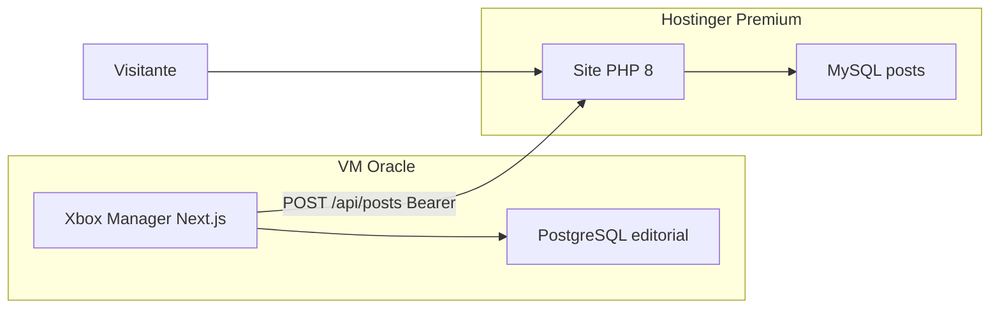

# Site público na Hostinger (sem WordPress)

## O que esse plano da Hostinger aguenta

Pelos números da conta (1 CPU, 2 GB RAM, 40 PHP workers, 100 GB, 100 sites), isso é **hospedagem web Premium**, não VPS e não o plano Business/Cloud com “Web Apps”.

| Formato | Neste plano |
| --- | --- |
| WordPress + PHP + MySQL | Nativo (é o que está no ar hoje) |
| HTML/CSS/JS estático | Sim |
| PHP 8 + MySQL/MariaDB | Sim — melhor opção nativa |
| Next.js SSR (`next start`, rotas de API, Server Actions) | Não — Node.js Apps só entra no plano Business ou Cloud |
| PostgreSQL | Não — Hostinger só oferece Postgres em VPS |
| Next.js `output: 'export'` | Só se o HTML for gerado noutro sítio e enviado por FTP/SFTP a cada notícia |

O **Xbox Manager** em `c:\Projetos\Xbox Manager` já é Next.js 15 + Prisma + **PostgreSQL**, com `output: "standalone"`, e está na VM Oracle (`xboxmanager.pastorxbox.com.br`). Esse painel **não** deve ir para a Hostinger.

## Melhor linguagem e banco para o site público

- **Linguagem: PHP 8** — é o runtime que este plano já tem (os 40 PHP workers existem por isso).
- **Banco: MySQL/MariaDB** — já existe na conta (`u285071835_Wqvpi`, 33 MB do WordPress). Criar uma base **nova** para o site, não reutilizar as tabelas `wp_*`.
- **Não usar PostgreSQL** na Hostinger.
- **Sem Next.js na Hostinger** — decisão confirmada. O site público é só PHP. O Next.js fica no Xbox Manager (VM Oracle).

PHP gera HTML no pedido (bom para SEO) e recebe o post na hora pela API.

## Layout e API em PHP (esclarecimento)

PHP **não** é mais flexível que Next.js no layout. Os dois deixam desenhar HTML/CSS/JS à vontade. Quem limita o layout hoje é o **WordPress** (tema, Gutenberg, shortcodes, plugins).

Sair do WordPress para PHP próprio = a mesma liberdade de layout que teria num site Next.js: home, grelha, artigo, tipografia, dark mode, componentes — tudo no código, sem tema.

A diferença prática neste plano:

- **PHP na Hostinger** — layout 100% seu + HTML gerado no servidor (SEO) + API no mesmo sítio.
- **Next.js** — a mesma liberdade de layout, mas SSR não corre neste plano Premium.

Sim, PHP tem API. O WordPress REST (`/wp-json/wp/v2/posts`) já é PHP. No site novo a API é nossa, no mesmo projecto:

- **Escrita (Manager → site):** `POST /api/posts`, `POST /api/posts/{id}`, `POST /api/media` (Bearer).
- **Sem API de leitura pública na v1** — o visitante só vê HTML. Menos superfície de ataque.

Não precisa de um segundo servidor Node só para ter API.

## Arquitetura

O Xbox Manager continua a ser a redação. O site na Hostinger passa a ser só a vitrine. A publicação canónica deixa de ser o REST do WordPress (`[wordpress.ts](c:\Projetos\Xbox Manager\src\lib\wordpress.ts)`) e passa a ser uma API PHP.

O canal `WORDPRESS` no Prisma **mantém-se** (evita migração de enum). Troca-se só o adaptador HTTP e, na UI, o rótulo “WordPress” por “Site”. O fluxo actual permanece: rascunho → publicar no site → só depois Telegram/X/Bluesky. Campos `wpPostId` / `wpPostUrl` / `canonicalWpBody` continuam a guardar o id e o URL públicos.

**O site PHP não tem gerenciador.** Sem login, sem `/admin`, sem utilizadores, sem formulário de publicação. A única escrita é a API chamada pelo Xbox Manager. phpMyAdmin no Docker é só local; na Hostinger não se instala nenhum painel.

Regras que valem em todas as fases: PHP 8 + MySQL; sem Next.js na Hostinger; URLs `/?p={id}`; WordPress de produção intacto até a fase 8.

## 8 fases (uma de cada vez)

Não avançar de fase sem o teste no fim passar. Fases 1–7 são locais. A fase 8 é a única que mexe na Hostinger.

### Fase 1 — Ambiente local

**Faz:** `docker-compose.yml` (PHP 8 + Apache em `http://localhost:8080`, MySQL 8, phpMyAdmin em `:8081` só local). `config.php` / `.env` **fora** do document root. Homepage mínima (“Pastor Xbox”) sem dados. Sem painel.

**Teste:** `docker compose up` → abre `http://localhost:8080` e o phpMyAdmin. `config.php` por URL dá 403/404. Produção WordPress continua no ar.

### Fase 2 — Layout da vitrine

**Faz:** HTML/CSS duas colunas. Sidebar: `#ad-sidebar-top`, tweets `@PastorXbox` (embed + fallback “Ver no X”), `#ad-sidebar-bottom`. Placeholders `#ad-header` e `#ad-in-article`. Aviso simples de cookies; GA4 só depois do opt-in e só se `GA_MEASUREMENT_ID` estiver preenchido (vazio em local).

**Teste:** Visual no browser — header, ads vazios, caixa do X, aviso de cookies. Sem `/admin` em lado nenhum.

### Fase 3 — Conteúdo e URLs `?p=`

**Faz:** Tabela `posts` (`id` PK, índice `(status, published_at)`). `index.php`: sem `p` → home paginada (`/?paged=2`); com `p` → artigo; id inexistente → 404. `GET /health` → `{ "ok": true }`. Open Graph/canonical em `/?p={id}`. Seed SQL de 1 post de teste com `id=1`.

**Teste:** `http://localhost:8080/?p=1` mostra o seed. Home lista-o. `/?p=999999` é 404. `/health` responde ok.

### Fase 4 — Importar o WordPress (site ainda no ar)

**Faz:** CLI `tools/import-wordpress.php` (não é URL). Lê `https://pastorxbox.com.br/wp-json/wp/v2/posts` (publicados, paginado, `_embed`). Grava com o **id original**. Descarrega featured + imagens do corpo para `public/uploads/`, reescreve `src`. `AUTO_INCREMENT = MAX(id)+1`. Idempotente.

**Teste:** `http://localhost:8080/?p=1194` é a mesma notícia que em produção (título, corpo, imagens **locais**, não hotlink). Home mostra o acervo. Correr o import outra vez não duplica ids.

### Fase 5 — API de publicação (sem gerenciador)

**Faz:** Só escrita, só POST: `/api/posts`, `/api/posts/{id}`, `/api/media`. Bearer `SITE_API_KEY`; sem chave → 401. HTMLPurifier. Upload: MIME real, re-encode GD, nome aleatório, PHP desligado em `uploads/`. Content-Type + teto ~8 MB. HTTPS obrigatório só fora de localhost. Sem GET de leitura JSON.

**Teste (curl):** sem token → 401; com token → cria post e devolve `url` `http://localhost:8080/?p={id}` com id **maior** que o acervo WP; republicar o mesmo id actualiza; ficheiro `.php` em media é rejeitado; abrir `/api/` no browser não é um painel.

### Fase 6 — Xbox Manager aponta para o local

**Faz:** Adaptador `[src/lib/pastor-site.ts](c:\Projetos\Xbox Manager\src\lib\pastor-site.ts)` no lugar de `publishToWordPress`. Env de **dev**: `SITE_BASE_URL=http://localhost:8080` + `SITE_API_KEY`. UI: rótulo “WordPress” → “Site” (enum Prisma inalterado). Ping `/health` antes de publicar. Produção do Manager e o WordPress **não** mudam.

**Teste:** No painel local do Manager, publicar um artigo novo → aparece no Docker com `/?p=` novo. Republicar um que já tem `wpPostId` (id importado) actualiza o mesmo `/?p=` sem criar outro.

### Fase 7 — Cache, SEO e QA local fechado

**Faz:** `Cache-Control`/`ETag` nas páginas HTML; `/api/` e `/health` sem cache. `sitemap.xml` e `rss.xml` com `/?p={id}`. `.htaccess`: bloquear `tools/` e config; `uploads/` sem PHP. Purge Cloudflare é no-op em local (só log). Checklist escrito para LiteSpeed vs Apache. Documentar rollback da fase 8. Não sobe nada à Hostinger.

**Teste:** Sitemap lista ids reais (incluindo 1194). RSS abre. Headers de cache no HTML. QA: home, artigo importado, artigo novo da fase 6, 404, health, API sem token. Se algo falhar, não há fase 8.

### Fase 8 — Cutover na Hostinger

Única fase que toca produção. Premium **não tem staging**.

**Faz:** Backup zip de `public_html` (inclui `wp-content/uploads`) + dump MySQL WP, **fora** da web. MySQL nova (não `wp_*`). Validar `.htaccess` no LiteSpeed. Cloudflare: SSL Full, WAF `/api/*` só IP da VM Oracle, Cache Rules (HTML sim; `/api/` e `/health` não), rate limit `/api/`. Swap para o PHP + uploads + dump já validados. Apontar Manager de **produção** para a API nova. Purge CF após POST.

**Teste:** `https://pastorxbox.com.br/?p=1194` igual ao local. `/health` ok. `/api/` sem Bearer ou de IP estranho falha. Post novo pelo Manager: id > acervo, home actualiza. Rollback: restaurar o zip WP em minutos se precisar.

## Fora de escopo

- Next.js (ou qualquer Node) na Hostinger
- Painel / login / gerenciador de conteúdos no site PHP
- Pretty permalinks (`/noticias/slug`)
- Importar páginas WP, rascunhos, comentários ou utilizadores
- Código real de AdSense (só placeholders)
- CMP de cookies completo (só aviso + opt-in do GA4)
- API de leitura JSON pública
- API do X no site público (só embed da timeline)
- Instagram Graph, Shorts, ou mudanças no ingest RSS
